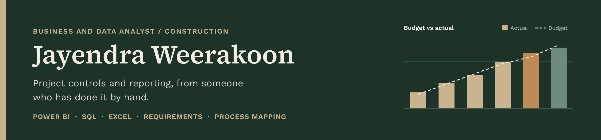
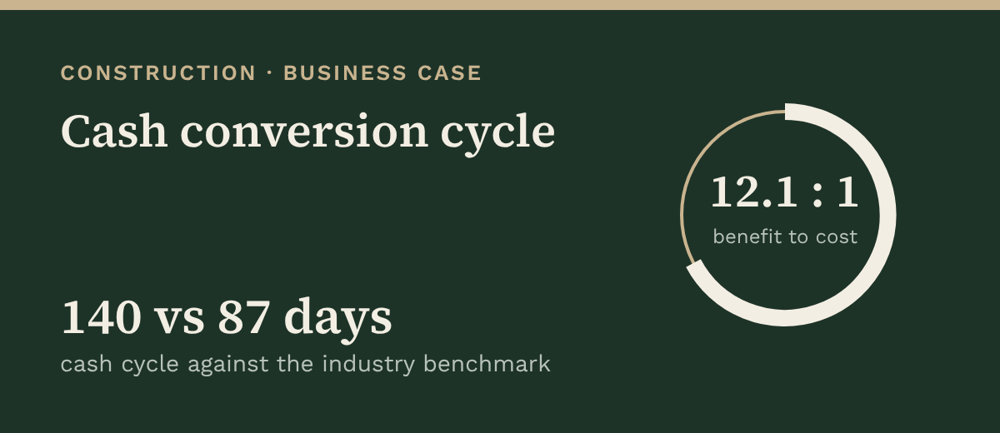
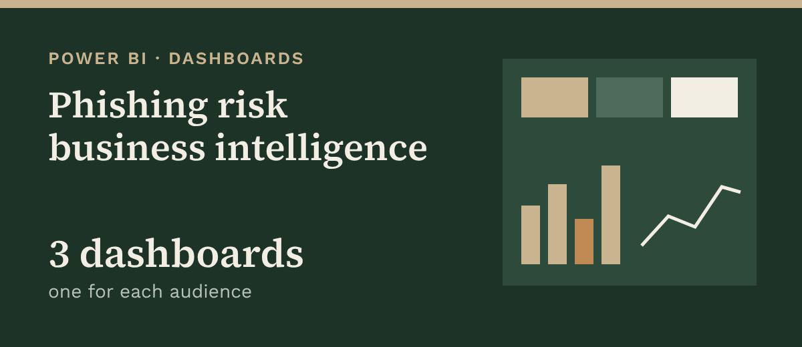
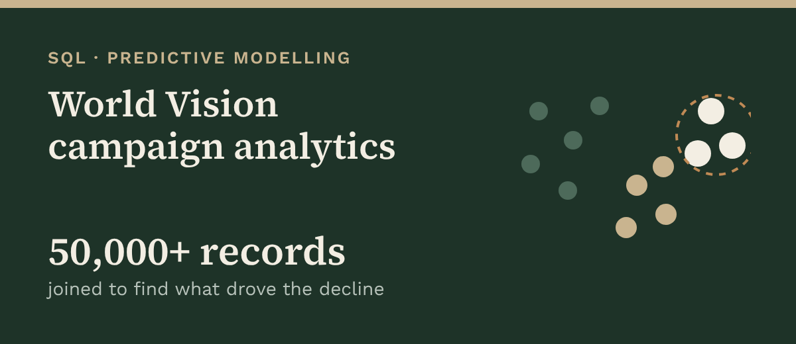
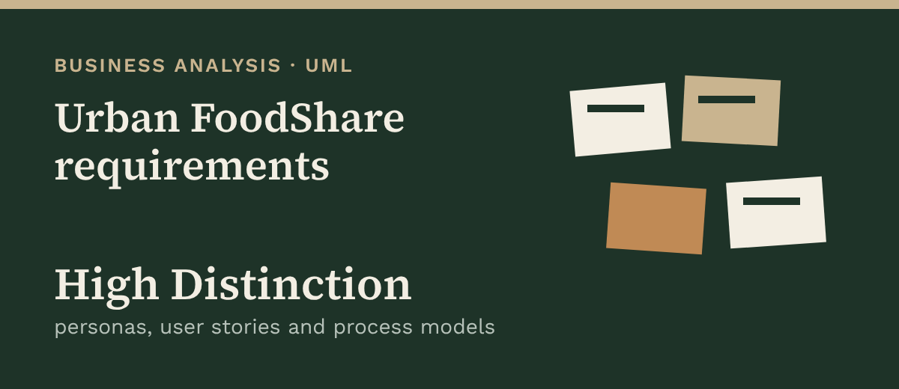

I spent years keeping construction projects on track with spreadsheets, paper registers and a lot of chasing. Now I use Power BI, SQL and Excel to do that work properly, so cost and progress problems show up early instead of at month end.

This is where the analysis behind that shift lives. Most of these projects begin with a real business problem, involve the people affected by it, and end with a recommendation someone can act on.

---

## Selected work

<table>
<tr>
<td width="50%" valign="top">

 
Traced a 140-day cash cycle on construction renovation projects to seven root causes through interviews with finance, procurement and operations, then designed fixes for inventory, receivables, progress invoicing and supplier payments.
</td>
<td width="50%" valign="top">

 
Three role-specific Power BI dashboards for campaign managers, HR and users. On a construction project, the same idea gives a site view, a project manager view and an executive summary.
</td>
</tr>
<tr>
<td width="50%" valign="top">

 
Joined over 50,000 donor records in SQL and KNIME and showed gift size, not response rate, drove a fall from about $21 million to $1 million. The same approach works on a cost overrun.
</td>
<td width="50%" valign="top">

 
Turned a food waste problem into functional, quality and business requirements, with personas, user stories, acceptance criteria and UML models.
</td>
</tr>
</table>

---

## More projects

| Project | What it shows |
|---|---|
| [Reserve Bank of Australia: firewall request process](https://github.com/jayendra-projects/rba-firewall-process-analysis) | BRD, user stories, current and future state process models, Power BI |
| [Horizon Health: mobile platform analysis](https://github.com/jayendra-projects/horizon-health-mobile-platform-analysis) | Business rules, BPMN 2.0, UML use case and sequence models |
| [Refinery profit optimisation](https://github.com/jayendra-projects/ampol-refinery-optimisation) | Cost and capacity modelling in Excel Solver, sensitivity analysis |
| [Customer RFM analytics in SQL](https://github.com/jayendra-projects/customer-rfm-analytics-sql) | BigQuery, CTEs, window functions, segmentation |
| [Queensland school staffing ratios](https://github.com/jayendra-projects/qld-student-teacher-ratio-analysis) | Cleaning and reshaping 20 years of ABS data in Excel |
| [Airline customer experience analytics](https://github.com/jayendra-projects/airline-customer-experience-analytics) | Python, sentiment analysis, topic modelling on 50,000 reviews |

---

## What I work with

**Project controls and reporting**

**Business analysis**

**Data and tools**

---

I'm looking for project controls, project analyst and business analyst roles in construction, infrastructure and local government in Victoria, and I'm open to project and analyst roles in other industries too. Always happy to have a chat.
